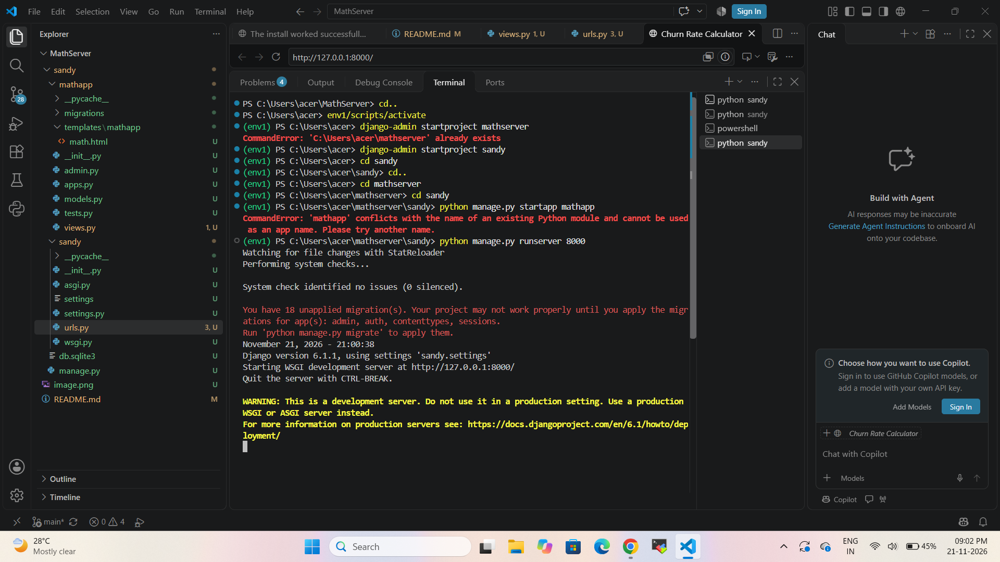
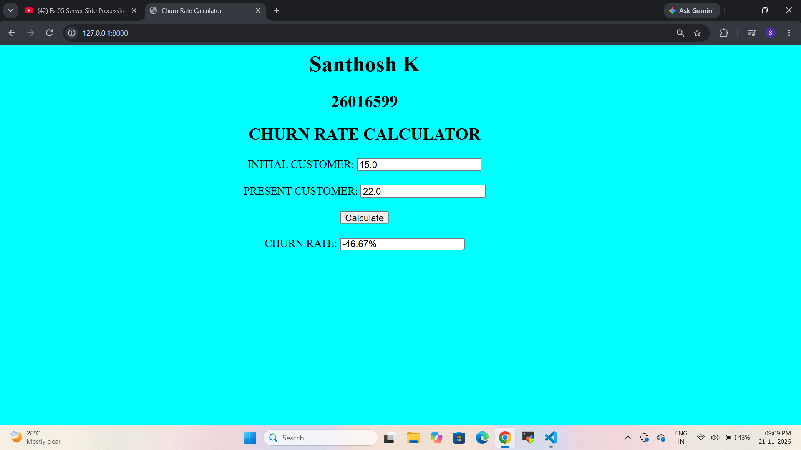

# Ex.03 Design a Website for Server Side Processing
## Date:15.11.2026

## AIM:
To create a web page to calculate Churn Rate using server-side scripts.

## FORMULA:
Churn Rate = (CustLost / InitCust) * 100
<br> InitCust --> Initial Customers Count
<br> CustLost --> Customers Lost Count

## DESIGN STEPS:

### Step 1:
Clone the repository from GitHub.

### Step 2:
Create Django Admin project.

### Step 3:
Create a New App under the Django Admin project.

### Step 4:
Create a HTML file to implement form based input and output.

### Step 5:
Create python programs for views and urls to perform server side processing.

### Step 6:
Receive input values from the form using request.POST.get().

### Step 7:
Calculate the Result using the given formula.

### Step 8:
Display the calculated result in the server console.

### Step 9:
Render the result to the HTML template.

### Step 10:
Publish the website in Localhost.

## PROGRAM:
```
math.html

<html>
<head>
    <title>Churn Rate Calculator</title>
</head>

<body bgcolor="aqua">

    <center>
        <h1>Santhosh K</h1>
        <h2>26016599</h2>

        <h2>CHURN RATE CALCULATOR</h2>

        <form method="POST">
            

            <label>INITIAL CUSTOMER:</label>
            <input type="number" name="initial_cust"
                   value="{{ l }}" min="0" step="any" required>

            <br><br>

            <label>PRESENT CUSTOMER:</label>
            <input type="number" name="present_cust"
                   value="{{ i }}" min="0" step="any" required>

            <br><br>

            <input type="submit" value="Calculate">

            <br><br>

            <label>CHURN RATE:</label>
            <input type="text"
                   value="{{ churnrate|floatformat:2 }}%"
                   readonly>

            <br><br>


        </form>
    </center>

</body>
</html>
 
views.py

from django.shortcuts import render

def churn_rate(request):
    l = 0
    i = 0
    churnrate = None
    error = ""

    if request.method == "POST":
        try:
            l = float(request.POST.get('initial_cust') or 0)
            i = float(request.POST.get('present_cust') or 0)

            if l <= 0:
                error = "Initial customers must be greater than zero."
            elif i < 0:
                error = "Present customers cannot be negative."
            else:
                churnrate = ((l - i) / l) * 100

        except ValueError:
            error = "Please enter valid numbers."

    return render(
        request,
        'mathapp/math.html',
        {
            'l': l,
            'i': i,
            'churnrate': churnrate,
            'error': error
        }
    )

urls.py

from django.contrib import admin
from django.urls import path
from mathapp import views

urlpatterns = [
    path('', views.churn_rate, name='churn_rate'),
]
```

## OUTPUT - SERVER SIDE:


## OUTPUT - WEBPAGE:



## RESULT:
The the web page to calculate Churn Rate using server-side scripts is created successfully.
